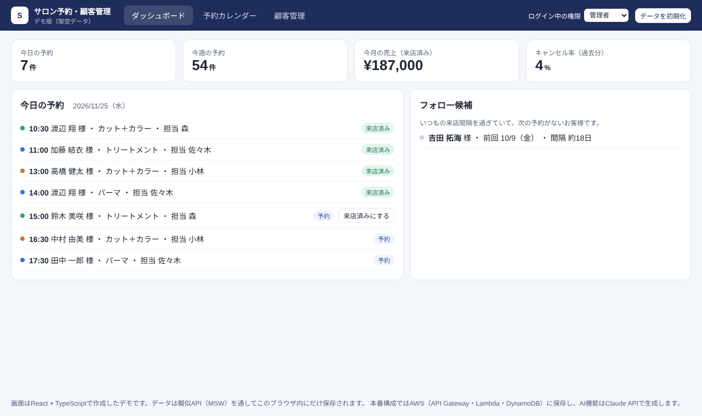
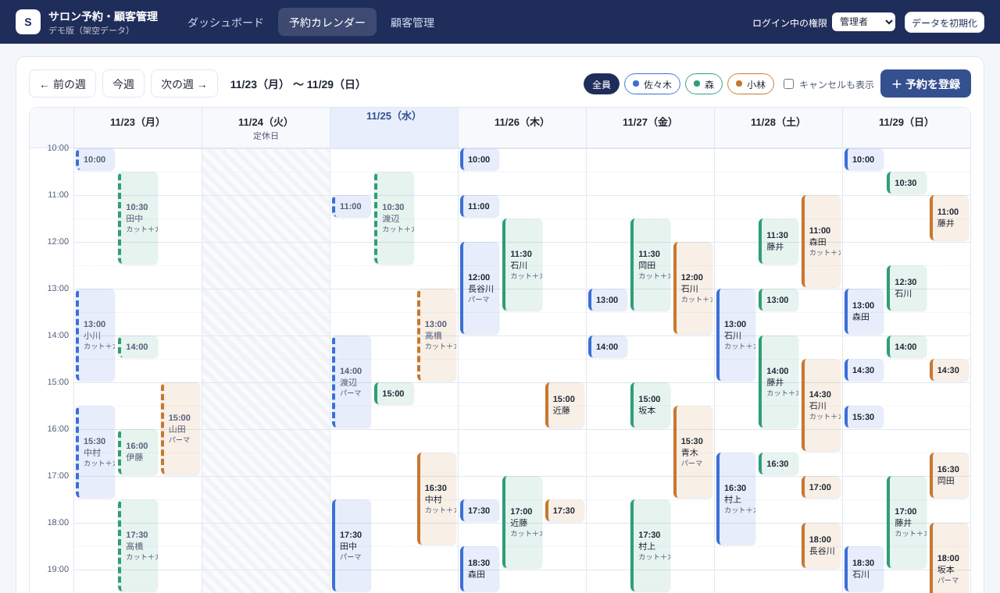
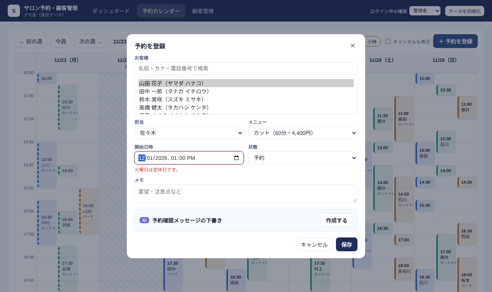
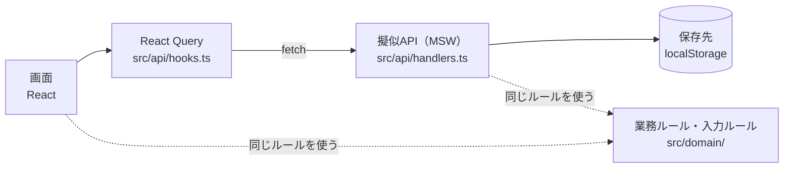

# サロン予約・顧客管理（デモ）

[](https://github.com/takahkok0812/salon-demo/actions/workflows/ci.yml)

美容室・整体などの小さな店舗向けの、予約と顧客をまとめて管理するWebアプリのデモです。データはすべて架空です。

**デモ：https://takahkok0812.github.io/salon-demo/** （右上で「管理者／スタッフ」を切り替えると表示が変わります）



## できること

- **ダッシュボード**：今日の予約、今週の予約件数、今月の売上、キャンセル率、フォロー候補（いつもの来店間隔を過ぎて次の予約がないお客様）
- **予約カレンダー**：週表示、担当者ごとの色分けと絞り込み、空き枠クリックで予約登録
  - 担当者の予約の重なり、定休日、営業時間外を登録時にチェック（画面とAPIの両方で同じルール）
- **顧客管理**：検索、来店履歴、接客メモ、CSVの書き出し・取り込み（数式インジェクション対策、形式の合わない行は行番号つきで知らせる）
- **権限**：管理者／スタッフで表示を切り替え（スタッフは売上・金額を非表示、連絡先は一部伏せ字、CSV入出力と予約削除は不可。APIでも拒否）
- **AI機能**：来店履歴の要約、予約確認メッセージの下書き
  - デモ版はブラウザだけで動かすため定型文で代用。本番構成ではサーバー側から Claude API を呼び出します

| 予約カレンダー | 入力エラーの表示 |
| --- | --- |
|  |  |

## 技術

| 分類 | 使っているもの |
| --- | --- |
| 画面 | React 19、TypeScript（strict）、Vite |
| データ取得 | TanStack Query（React Query）、REST API |
| API（デモ） | MSW（ブラウザ内で動く擬似API） |
| フォーム | React Hook Form、Zod |
| テスト | Vitest、MSW（Node）、Playwright、axe-core |
| CI | GitHub Actions（型チェック・lint・単体テスト・build・E2E） |
| 本番構成（設計） | AWS SAM：CloudFront + S3、API Gateway + Lambda、DynamoDB、Cognito |

## 構成



デモ版の擬似APIは、本番構成の API Gateway + Lambda の役割を代わりに担っています。業務ルールは React にも MSW にも依存しない純粋な TypeScript なので、そのまま Lambda に持っていけます。本番構成は [design/architecture.md](design/architecture.md) と [infra/template.yaml](infra/template.yaml) にまとめています（デプロイはしていません）。

## 設計で考えたこと

| 判断 | 理由 |
| --- | --- |
| 業務ルールを `src/domain/` の純粋関数にした | 画面を動かさずに、入力と期待値だけで境界値をテストできる。画面とAPIで同じ関数を使える |
| 現在時刻を引数で受け取る | `new Date()` を中で呼ぶと、テストの結果が実行日で変わる |
| 入力ルールを Zod のスキーマ1か所にまとめた | 画面のフォームとAPIで、エラーメッセージまで同じにできる |
| 業務ルールと権限をAPI側でも確認する | 画面のチェックは使いやすさのため。別の人が同じ枠を先に取った場合や、画面を通さないリクエストは、APIでしか防げない |
| 新規の id をAPI側で採番する | 本番構成と同じ責任分担にするため |
| 4つのAPIを並列に取得し、更新後は関係するデータだけを取り直す | 予約を変えたら予約だけ再取得し、通信を減らす |
| 「来店済みにする」は楽観的更新にした | 応答を待たずに表示を変えて操作を軽くする。失敗したら元に戻してエラーを出し、最後にサーバーの内容で取り直してそろえる |
| CSV取り込みは、形式の合わない行があれば1件も取り込まない | 途中まで取り込まれて、どこまで入ったか分からなくなるのを防ぐ |
| 来店済みの予約を透明度ではなく点線で区別した | 透明度で薄くすると文字のコントラストが足りなくなる |

## テスト

| 種類 | 内容 | 件数 | 実行 |
| --- | --- | --- | --- |
| 単体テスト | 予約ルールの境界値、日付計算、CSV、集計、入力スキーマ、サンプルデータがルールを満たすこと、楽観的更新の書き換え | 52 | `npm test` |
| APIテスト | 擬似APIのステータスコード（422・404・403）、id の採番、CSV取り込み | 9 | `npm test` |
| E2Eテスト | 予約の登録・重なり・定休日、顧客フォームのエラーと保存、スタッフ権限の表示、楽観的更新の成功と失敗 | 8 | `npm run e2e` |
| アクセシビリティ | axe（WCAG 2.1 A/AA）で主要な画面とダイアログ、キーボード操作（フォーカス移動・Esc・Tab） | 7 | `npm run e2e` |

- サンプルデータは「今日」を基準に作られるため、単体テストは時間帯を日本時間に固定し、E2E は時計も固定しています。
- E2E の空き枠は、決め打ちの時刻ではなく擬似APIの予約一覧から探すので、サンプルデータを変えてもテストが壊れにくくしています。

## 開発の進め方

改修は Issue → プルリクエスト → CI 成功 → マージ の順で進めています。

| PR | 内容 |
| --- | --- |
| [#8](https://github.com/takahkok0812/salon-demo/pull/8) | 型チェックを strict にし、CIを追加 |
| [#9](https://github.com/takahkok0812/salon-demo/pull/9) | 予約ルールを画面から切り出し、単体テストを追加 |
| [#10](https://github.com/takahkok0812/salon-demo/pull/10) | データの取得・更新を擬似APIと React Query 経由に変更 |
| [#12](https://github.com/takahkok0812/salon-demo/pull/12) | サンプルデータで同じ担当者の予約が重ならないようにする（作業中に見つけた不具合 #11） |
| [#13](https://github.com/takahkok0812/salon-demo/pull/13) | フォームの入力チェックを React Hook Form + Zod に移行 |
| [#14](https://github.com/takahkok0812/salon-demo/pull/14) | Playwright で E2E テストを追加 |
| [#15](https://github.com/takahkok0812/salon-demo/pull/15) | アクセシビリティを改善し、axe の自動チェックを追加 |
| [#16](https://github.com/takahkok0812/salon-demo/pull/16) | README と本番構成の設計（AWS SAM、未デプロイ） |
| [#18](https://github.com/takahkok0812/salon-demo/pull/18) | 予約の状態変更を楽観的更新に（失敗時は元に戻す） |

## 動かし方

```bash
npm install
npm run dev          # 開発サーバー
npm test             # 単体テスト・APIテスト
npx playwright install chromium
npm run e2e          # E2Eテスト（ビルドしてから自動で起動）
npm run build        # dist/ に出力（画面は1ファイル＋擬似API用の mockServiceWorker.js）
npm run build:pages  # 公開デモ用に docs/ へ出力
```

## ファイル構成

```
src/
  App.tsx                 画面の枠・タブ・読み込み中とエラーの表示
  main.tsx                擬似APIを起動してから画面を描く
  role.tsx                権限（管理者／スタッフ）の切り替え
  types.ts                型定義
  domain/                 業務ルール（React・MSWに依存しない）
    booking.ts            予約の検証（定休日・営業時間・担当者の予約の重なり）
    dashboard.ts          売上・キャンセル率・フォロー候補の集計
    schemas.ts            入力ルール（Zod）。画面とAPIで共通
  api/
    hooks.ts              React Query のフック
    client.ts             fetch とエラーの型
    handlers.ts           擬似API（MSW）。本番構成では Lambda
    db.ts                 擬似APIの保存先（localStorage）。本番構成では DynamoDB
  components/             画面とダイアログ
  hooks/useDialog.ts      ダイアログのキーボード操作
  lib/                    日付・CSV・AI（デモ版）
  data/seed.ts            架空のサンプルデータ
e2e/                      Playwright の E2E・アクセシビリティテスト
design/architecture.md    本番構成の設計
infra/template.yaml       本番構成の AWS SAM テンプレート（未デプロイ）
docs/                     公開デモ（GitHub Pages）
```
