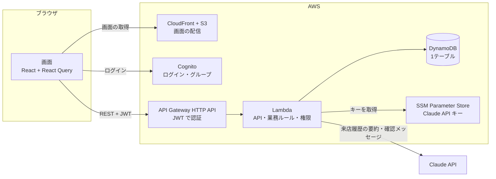

# 本番構成の設計

デモ版は、ブラウザだけで動くように擬似API（MSW）でサーバーの役割を代わりに担っています。この文書は、実際のお店で使う場合の構成をまとめたものです。テンプレートは [`infra/template.yaml`](../infra/template.yaml)（AWS SAM）にあり、`cfn-lint` で検証していますが、デプロイはしていません。

## 構成

| デモ版 | 本番構成 |
| --- | --- |
| 擬似API（MSW、`src/api/handlers.ts`） | API Gateway + Lambda |
| ブラウザの localStorage（`src/api/db.ts`） | DynamoDB |
| 画面右上の「権限」切り替え（リクエストヘッダー） | Cognito のグループ（`admin` / `staff`）を JWT から判定 |
| 定型文で作る AI の下書き（`src/lib/ai.ts`） | Lambda から Claude API を呼ぶ |

業務ルール（`src/domain/booking.ts`）と入力ルール（`src/domain/schemas.ts`）は、画面にも Lambda にもそのまま持っていけるよう、React や MSW に依存しない純粋な TypeScript にしています。

## DynamoDB の設計（1テーブル）

| データ | pk | sk | gsi1pk | gsi1sk |
| --- | --- | --- | --- | --- |
| 担当者 | `SHOP#{店舗ID}` | `STAFF#{担当者ID}` | | |
| メニュー | `SHOP#{店舗ID}` | `MENU#{メニューID}` | | |
| お客様 | `SHOP#{店舗ID}` | `CUSTOMER#{お客様ID}` | `SHOP#{店舗ID}#CUSTOMER` | `{フリガナ}` |
| 予約 | `SHOP#{店舗ID}` | `BOOKING#{開始日時}#{予約ID}` | `STAFF#{担当者ID}` | `{開始日時}` |
| 予約枠のロック | `SHOP#{店舗ID}` | `SLOT#{担当者ID}#{30分枠の開始}` | | |

| 画面の操作 | 読み方 |
| --- | --- |
| 1週間分の予約を表示 | `pk = SHOP#…` かつ `sk` が `BOOKING#{週の初め}` 〜 `BOOKING#{週の終わり}` |
| 担当者の予約の重なりを確認 | `gsi1` で `gsi1pk = STAFF#…` かつ `gsi1sk` が予約の前後の範囲 |
| お客様の一覧・検索 | `pk = SHOP#…` かつ `sk` が `CUSTOMER#` で始まる。フリガナ順は `gsi1` |
| お客様の来店履歴 | 予約に `customerId` を持たせ、お客様の詳細を開いたときだけ絞り込む（件数が多くなったら GSI を追加） |

## 予約の二重登録を防ぐ

画面と API の両方で `validateBooking` を実行しても、2人がほぼ同時に同じ枠を予約すると、どちらの確認も通ってしまうことがあります。本番構成では、予約を書き込むときに、その予約が使う30分枠ごとのロック項目を同じトランザクション（`TransactWriteItems`）で作ります。

- ロック項目には `attribute_not_exists(pk)` の条件を付けるので、先に書いた方だけが成功します。
- 失敗した側には、画面と同じ「担当者の予約が重なっています」を返します。
- 予約の変更・キャンセルのときは、古い枠のロックを消して新しい枠のロックを作ります。
- ロック項目には予約の終了時刻を `expiresAt` に入れ、過ぎたものは TTL で自動的に消えます。

## 権限

- ログインは Cognito。招待した人だけが使えるようにし（`AllowAdminCreateUserOnly`）、二要素認証も選べます。
- API Gateway で JWT を検証し、Lambda では `cognito:groups` を見て、削除・CSV取り込み・売上の取得を `admin` だけに許可します。
- 画面で項目を隠すのは使いやすさのためで、制限そのものは API 側で行います（デモ版の擬似APIでも同じ考え方で、スタッフ権限の削除は 403 を返します）。

## AI 機能

- Claude API のキーは SSM Parameter Store（SecureString）に置き、Lambda が実行時に読み込みます。コードやテンプレートには書きません。
- 来店履歴の要約は、お客様の名前や連絡先を送らず、来店日・メニュー・接客メモだけを送ります。
- 生成した文章はそのまま送らず、画面で確認・編集してから使う前提です（デモ版の「下書き」と同じ）。

## 運用

- Lambda は X-Ray のトレースを有効にし、ログは CloudWatch Logs に30日保存します。
- DynamoDB はポイントインタイムリカバリを有効にし、テーブルは削除時も残す設定（`DeletionPolicy: Retain`）にしています。
